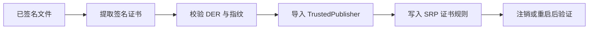

# CertLock

> Windows SRP 证书规则管理工具

[](https://github.com/zhaofeiy2002-ctrl/certlock/releases/latest)
[](LICENSE)
[](https://github.com/zhaofeiy2002-ctrl/certlock)

CertLock 为选定的代码签名证书写入 Windows 软件限制策略（SRP）规则，并提供规则查看、移除、备份、导入和路径例外管理。它不安装驱动、服务或后台进程。

## 工作方式



规则针对使用所选证书签名的文件。路径允许规则不能覆盖更高优先级的证书禁止规则。

## 常用预设：保留 WPS（v2.1.0）

点击“常用预设（保留 WPS）”，或通过“导入模板”选择随包的 `常用预设-保留WPS.json`。
支持 360、2345、鲁大师、腾讯共享签名和两张金山安全证书，共六张候选证书。

- 自动从 Windows 应用注册信息和常见目录寻找 WPS；找不到时跳过两张金山安全证书，这也意味着暂不封禁金山安全软件。可手动指定 WPS 安装目录。
- 读取 WPS 目录中 EXE/DLL 的嵌入签名，跳过所有同签名规则。不能解析或目录不完整时停止导入。
- 每条候选证书都可以取消勾选；“添加保留程序”可选择 QQ 等软件的 EXE，导入时跳过这些程序的签名。
- 勾选的模板可导出给别人，模板不记录本机路径；WPS 会在对方电脑重新检测，其他保留程序需要对方重新选择。
- WPS / Office 命名的签名主体始终从本预设排除；本机已有 WPS 签名冲突时停止，不替用户删除旧规则。
- 预览列出全部添加和跳过项、指纹及过期提示；导入前自动保存证书策略备份到 `%LOCALAPPDATA%\CertLock\backups`。备份失败则不导入。
- 腾讯证书并非电脑管家专用，同证书的 QQ、腾讯视频等也会受影响；确认列表后再导入。

这是有限证书预设，不是“除 WPS 外所有软件”的通用封禁。换证的新版本、无签名程序和未收录厂商不在覆盖保证内。WPS 核对限于所选目录中可读取的嵌入签名，不代替目标 Windows 环境实测。
必须用 v2.1.0 或更新版导入这个保护模板；旧版不识别 WPS 保护字段。

```powershell
# 无需管理员权限，导出预设与预览；不修改系统策略
CertLock.exe --preset-export common.json
CertLock.exe --dry-run --template-import common.json
CertLock.exe --dry-run --template-import common.json --wps-dir "C:\实际的WPS安装目录"
CertLock.exe --dry-run --template-import common.json --keep-file "C:\实际目录\QQ.exe"
# 管理员手动执行实际导入，或使用 GUI 确认导入
CertLock.exe --template-import common.json --wps-dir "C:\实际的WPS安装目录"
```

## 开始使用

[下载 CertLock v2.1.0 便携版](https://github.com/zhaofeiy2002-ctrl/certlock/releases/download/v2.1.0/CertLock_v2.1.0-portable.zip)

解压后，右键 `CertLock.exe` 并选择“以管理员身份运行”。写入策略需要管理员权限。

## v2.0.0

- 校验证书 DER 与证书指纹一致后再写入规则。
- 写入前导入本机“受信任的发布者”证书存储。
- 修复路径白名单首次写入时未初始化 SRP 根策略的问题。
- 修复路径白名单被误报为策略冲突的问题。
- 修复维护用 PowerShell 脚本的默认安全级别、证书规则开关和二进制证书写入。
- 停止创建未经验证的 SRP 哈希规则；保留旧规则查询和移除能力。
- 社区模板只导出证书规则。

完整记录见 [CHANGELOG.md](CHANGELOG.md)，最新发布文件见 [v2.1.0 Release](https://github.com/zhaofeiy2002-ctrl/certlock/releases/tag/v2.1.0)。

## 能做什么

| 功能 | 说明 |
| --- | --- |
| 证书规则 | 从已签名文件提取证书，并写入 SRP 禁止规则。 |
| 内置预设 | 提供仓库中已包含证书数据的预设。 |
| 路径白名单 | 为精确文件路径创建 SRP `Unrestricted` 例外。 |
| 规则管理 | 查看、移除、备份和还原证书规则。 |
| 命令行 | 支持封禁、列出、移除、导入、导出与试运行。 |
| 社区模板 | 导入和导出证书规则模板。 |

## 规则范围与注意事项

- 规则针对**使用所选代码签名证书签名的文件**，不等同于自动覆盖某一厂商的所有软件。
- 厂商更换签名证书后，旧规则不会覆盖使用新证书的文件；需要重新提取并添加该证书。
- v2.0.0 不创建普通 SHA-256 注册表哈希规则。Windows SRP 的哈希由其策略组件计算，普通 SHA-256 不足以证明规则可以匹配。
- 添加、移除或还原规则后，请注销并重新登录，或重启计算机，再验证目标程序行为。
- 请在隔离 Windows 环境中先验证规则，再用于日常工作环境。

## 操作步骤

1. 下载并解压 [v2.1.0 ZIP](https://github.com/zhaofeiy2002-ctrl/certlock/releases/download/v2.1.0/CertLock_v2.1.0-portable.zip)。
2. 右键 `CertLock.exe`，选择“以管理员身份运行”。
3. 选择内置预设，或选择一个已签名的 `.exe`、`.dll` 或 `.msi` 文件。
4. 确认显示的证书信息后写入规则。
5. 注销并重新登录或重启，再在隔离环境验证结果。

## 命令行使用

```powershell
# 从已签名文件提取证书并写入规则
CertLock.exe --block "C:\Path\To\signed-app.exe"

# 预览证书信息，不写入策略
CertLock.exe --dry-run --block "C:\Path\To\signed-app.exe"

# 查看规则
CertLock.exe --list
CertLock.exe --list --json
CertLock.exe --list --csv

# 按证书指纹移除规则
CertLock.exe --remove "7913DE9D7ED4EEEE790FF0680A4C802C1BC832AB"

# 备份与还原证书规则
CertLock.exe --export backup.json
CertLock.exe --import backup.json

# 导入与导出证书模板
CertLock.exe --template-export template.json
CertLock.exe --template-import template.json
```

`--hash` 在 v2.0.0 中不创建新规则，用于阻止继续写入未经验证的 SRP 哈希数据。

## 路径白名单

路径白名单是 SRP 原生的 `Unrestricted` 路径规则。SRP 匹配优先级为哈希、证书、路径、区域、默认规则，因此不能用 WPS 路径白名单覆盖同签名证书封禁。[微软规则优先级说明](https://learn.microsoft.com/en-us/troubleshoot/windows-server/group-policy/troubleshoot-software-restriction-policies)

## 策略位置

CertLock 使用以下策略路径：

```text
HKLM\SOFTWARE\Policies\Microsoft\Windows\Safer\CodeIdentifiers
```

证书规则的 `ItemData` 写入原始 DER 证书（`REG_BINARY`），并启用 `authenticodeenabled`。代码签名证书同时导入本机“受信任的发布者”证书存储。

## 构建

```powershell
git clone https://github.com/zhaofeiy2002-ctrl/certlock.git
cd certlock
pip install pyinstaller
python -m PyInstaller certlock.spec --clean --noconfirm
```

构建输出：`dist\CertLock.exe`。

运行测试：

```powershell
python -m unittest discover -s tests -v
```

## 贡献与许可

贡献说明见 [CONTRIBUTING.md](CONTRIBUTING.md)。本项目采用 [MIT License](LICENSE)。
